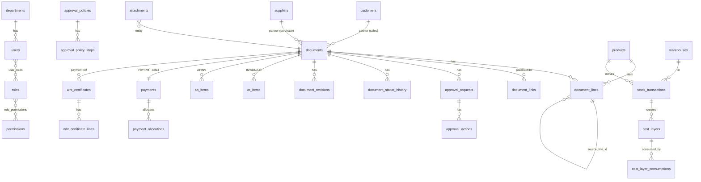

# PolyMate ERP — Database Schema (PostgreSQL 16)

วันที่: 2026-11-12 · สถานะ: **ร่างเพื่อขออนุมัติ** · อ้างอิงการตัดสินใจ D-5, D-6, D-7, D-9 ใน [Backend-Architecture](Backend-Architecture.md)

---

## 1. ข้อตกลงทั่วไป

| เรื่อง | กติกา |
|---|---|
| Primary key | `uuid` (สร้างแบบ UUIDv7 ในแอป เรียงตามเวลา จึงทำ index ได้ดี) ยกเว้น `audit_logs`, `stock_transactions` ใช้ `bigint identity` |
| รหัสธุรกิจ | แยกจาก PK เช่น `doc_no`, `customers.code` มี `UNIQUE` |
| เวลา | `timestamptz` ทั้งหมด, server ตั้ง `TZ=Asia/Bangkok`; วันที่เอกสารใช้ `date` |
| เงิน | `numeric(18,2)` · จำนวน `numeric(18,3)` (ตรงกับ `r3` เดิม) · ต้นทุนต่อหน่วย `numeric(18,6)` · อัตรา `numeric(7,4)` |
| คอลัมน์มาตรฐาน (ทุกตารางที่แก้ไขได้) | `created_at`, `created_by → users`, `updated_at`, `updated_by → users`, `version int not null default 1` (optimistic lock) |
| การลบ | ข้อมูลหลัก: `is_active=false` (ไม่ลบจริงเมื่อถูกอ้างอิง) · เอกสาร: ลบได้เฉพาะ `draft` ที่ไม่มีการอ้างอิง (soft delete `deleted_at`) · รายการบัญชี/สต๊อก/ภาษี: **ห้ามลบ ห้ามแก้** ใช้รายการกลับ |
| สถานะ | `text` + `CHECK (status IN (...))` (เพิ่มค่าใหม่ง่ายกว่า enum) |
| Multi-company | มี `company_id` ใน master/เอกสาร เผื่ออนาคต ตอนนี้มี 1 บริษัท |
| ชื่อ | snake_case, ตารางพหูพจน์ |
| Legacy | ตารางที่รับข้อมูลจากระบบเดิมมี `legacy_id text` เพื่อตรวจย้อนหลัง |

---

## 2. ภาพรวมความสัมพันธ์



---

## 3. ผู้ใช้ สิทธิ์ และการอนุมัติ

```sql
departments (id uuid pk, code text unique, name text, manager_user_id uuid null → users, is_active bool, +std)

users (
  id uuid pk, username citext unique, full_name text, email citext null, department_id uuid → departments,
  password_hash text,                 -- Argon2id
  password_algo text check in ('argon2id','sha256-legacy'),
  legacy_salt text null,              -- ใช้จนกว่าจะ rehash
  must_change_password bool, status text check in ('active','suspended'),
  failed_logins int default 0, locked_until timestamptz null, last_login_at timestamptz,
  legacy_id text, +std )
password_history (user_id → users, password_hash, changed_at)          -- กันใช้รหัสซ้ำ 5 รหัสล่าสุด

roles (id uuid pk, code text unique, name text, description text, is_system bool, +std)
permissions (code text pk, module text, description text)              -- seed จากโค้ด แก้จาก UI ไม่ได้
role_permissions (role_id → roles, permission_code → permissions, scope text check in ('all','own_department'),
                  primary key (role_id, permission_code))
user_roles (user_id → users, role_id → roles, primary key (user_id, role_id))

sessions (
  id uuid pk, token_hash bytea unique, user_id → users, csrf_token text,
  created_at, last_seen_at, expires_at, revoked_at null, revoke_reason text, ip inet, user_agent text )
  index (user_id) where revoked_at is null

approval_policies (
  id uuid pk, doc_type text → doc_types, department_id uuid null,      -- null = ทุกแผนก
  action text check in ('approve','cancel','edit_approved'),
  name text, allow_self_approval bool default false, is_active bool, effective_from date, +std,
  unique (doc_type, department_id, action, effective_from) )
approval_policy_steps (
  id uuid pk, policy_id → approval_policies, step_no int,
  min_amount numeric(18,2) default 0, max_amount numeric(18,2) null,  -- ขั้นนี้ใช้เมื่อยอดอยู่ในช่วง
  approver_role_id uuid null → roles, approver_user_id uuid null → users,
  approver_scope text check in ('any_department','same_department'),
  required_count int default 1,
  check (approver_role_id is not null or approver_user_id is not null),
  unique (policy_id, step_no, min_amount) )

approval_requests (
  id uuid pk, document_id → documents, action text, status text check in ('pending','approved','rejected','returned','withdrawn'),
  amount numeric(18,2), policy_snapshot jsonb,                         -- ขั้นตอนที่ใช้ ณ เวลาขอ (แก้นโยบายภายหลังไม่กระทบคำขอเดิม)
  current_step int, requested_by → users, requested_at, completed_at, reason text )
  unique (document_id) where status = 'pending'                        -- คำขอค้างได้ครั้งละ 1
approval_actions (
  id uuid pk, request_id → approval_requests, step_no int, actor_id → users,
  decision text check in ('approve','reject','return'), comment text, acted_at timestamptz,
  unique (request_id, step_no, actor_id) )
```

ตัวอย่างนโยบาย (ตั้งจาก UI):

| doc_type | action | ขั้น | ช่วงยอด (บาท) | ผู้อนุมัติ |
|---|---|---|---|---|
| SO | approve | 1 | 0 – ไม่จำกัด | sales_manager |
| PO | approve | 1 | 0 – 50,000 | procurement_manager |
| PO | approve | 1 | 50,000.01 – ไม่จำกัด | procurement_manager |
| PO | approve | 2 | 50,000.01 – ไม่จำกัด | approver (ผู้มีอำนาจ) |
| INV | cancel | 1 | ทุกยอด | accounting_manager |

---

## 4. ข้อมูลหลัก (Master data)

```sql
companies (id uuid pk, name_th, name_en, tax_id char(13) check (tax_id ~ '^\d{13}$'), branch_code text default '00000',
           address, phone, email, logo_attachment_id, +std)

customers (id uuid pk, company_id, code text unique, name, name_en, tax_id text, branch_code text,
           contact, phone, email, address, credit_days int check >= 0, credit_limit numeric(18,2) null,
           segment text, status text check in ('active','watch','inactive'), legacy_id, +std)
suppliers (id uuid pk, company_id, code text unique, name, tax_id, branch_code, contact, phone, email, address,
           category text, credit_days int, rating numeric(3,2), wht_default_rate numeric(7,4) default 0,
           pnd_form text check in ('PND3','PND53') null, status text, legacy_id, +std)

uoms (code text pk, name text)                                         -- PCS, KG, BOX ...
product_categories (id uuid pk, code text unique, name, parent_id null)
products (
  id uuid pk, company_id, code text unique, name, kind text check in ('RM','COLOR','PACK','STEEL','FG','TRADE','SPARE'),
  job_type text check in ('oem','own','trade') null,                   -- เฉพาะ FG/TRADE
  category_id null, uom_code → uoms, customer_id null → customers,
  color text, weight_g numeric(12,3), standard_cost numeric(18,6), sale_price numeric(18,2),
  min_qty numeric(18,3), max_qty numeric(18,3), default_location text, default_supplier_id null → suppliers,
  is_stocked bool default true, is_active bool, legacy_id, +std )
  -- รวม MATERIALS + FINISHED เดิมเป็นตารางเดียว (เดิม DO ค้นสต๊อกจากทั้งสองชุดด้วย code อยู่แล้ว)

warehouses (id uuid pk, company_id, code text unique, name, is_active, +std)   -- seed: MAIN

boms (id uuid pk, product_id → products, revision int, mold_id null → molds, waste_rate numeric(7,4),
      packaging_note text, is_active bool, effective_from date, +std, unique (product_id, revision))
bom_lines (id uuid pk, bom_id → boms, line_no int, component_id → products, qty_per_unit numeric(18,6), uom_code)

machines (id text pk /* INJ-01 */, name, tonnage int, status text, is_active, +std)
molds (id uuid pk, code text unique, name, customer_id null, cavities int check > 0, size text, weight_kg numeric,
       machine_min_ton int, machine_max_ton int, shots bigint, life_shots bigint, last_maint_date date,
       status text check in ('available','in-use','maintenance','alert','retired'), location text, legacy_id, +std)
mold_maintenance (id uuid pk, mold_id → molds, maint_date date, note text, cost numeric(18,2),
                  shots_at bigint, reset_shots bool, expense_document_id null → documents, +std)
vehicles (id uuid pk, code text unique, plate, type, driver, phone, is_active, +std)
employees (id uuid pk, code text unique, name, position, department_id, phone, joined_date date,
           salary numeric(18,2), user_id null → users, is_active, legacy_id, +std)
           -- คอลัมน์ salary อ่านได้เฉพาะ permission hr.salary.read
wht_income_types (code text pk, name text, default_rate numeric(7,4), pnd_section text)  -- 40(2), 40(8) ค่าขนส่ง 1%, บริการ 3% ...
```

---

## 5. เอกสาร (Document engine — ใช้กับทุกประเภท)

### 5.1 ประเภทเอกสาร (`doc_types` — ตั้งค่าแทนค่าคงที่ `PREFIX`, `NEXT` เดิม)

| code | ชื่อ | prefix | ฝั่ง | กระทบ | ต่อไปเป็น |
|---|---|---|---|---|---|
| CPO | PO ลูกค้า | CPO | ขาย | — | SO |
| QT | ใบเสนอราคา | QT | ขาย | — | SO |
| SO | ใบสั่งขาย | SO | ขาย | (จอง) | DO, WO* |
| DO | ใบส่งสินค้า | DO | ขาย | สต๊อก − , COGS | BN, INV, SR |
| BN | ใบวางบิล | BL | ขาย | — | INV |
| INV | ใบกำกับภาษี | IV | ขาย | ลูกหนี้ +, ภาษีขาย | RC, CN, DN |
| RC | ใบเสร็จรับเงิน | RE | ขาย | — | PAY |
| PAY | รับชำระเงิน | RV | ขาย | ลูกหนี้ − | — |
| CN | ใบลดหนี้ | CN | ขาย | ลูกหนี้ −, ภาษีขาย − | — |
| DN | ใบเพิ่มหนี้ | DN | ขาย | ลูกหนี้ +, ภาษีขาย + | RC |
| SR | ใบรับคืนสินค้า | SR | ขาย | สต๊อก +, COGS − | CN |
| PR | ใบขอซื้อ | PR | ซื้อ | — | PO |
| PO | ใบสั่งซื้อ | PO | ซื้อ | — | GR |
| GR | ใบรับสินค้า | GR | ซื้อ | สต๊อก +, cost layer | APINV, PRT |
| APINV | ใบแจ้งหนี้ผู้ขาย | AP | ซื้อ | เจ้าหนี้ +, ภาษีซื้อ | PV, (CN จากผู้ขาย) |
| PRT | ใบส่งคืนสินค้า | PRT | ซื้อ | สต๊อก −, เจ้าหนี้ − | — |
| PV | ใบสำคัญจ่าย | PV | ซื้อ | — | PMT |
| PMT | จ่ายชำระเงิน | PM | ซื้อ | เจ้าหนี้ −, WHT ที่หัก | — |
| EXP | ค่าใช้จ่ายทั่วไป | EX | ซื้อ | เจ้าหนี้ + | PV |
| ADJ | ใบปรับปรุงสต๊อก | ADJ | คลัง | สต๊อก ± | — |
| CCM | เปลี่ยนวิธีคิดต้นทุน | CCM | คลัง | revaluation | — |

\* WO อยู่ในตาราง `work_orders` แยก (มีข้อมูลการผลิตเฉพาะ) แต่อ้างอิง `so_line_id`

```sql
doc_types (code text pk, name_th, name_en, prefix text unique, direction text check in ('sales','purchase','inventory'),
           affects_stock smallint check in (-1,0,1), affects_ledger text check in ('AR','AP','none'),
           number_on text check in ('create','approve'),               -- D-6: ค่าเริ่มต้น approve; QT/CPO/PR/PO = create
           requires_approval bool, next_types text[], sort_order int)
number_sequences (series_key text pk /* 'IV202611' */, last_value int not null check >= 0, updated_at)
                  -- ไม่มีการลดค่า ไม่มีการคืนเลข
```

### 5.2 `documents`

```sql
documents (
  id uuid pk, company_id, doc_type text → doc_types,
  doc_no text null,                         -- null ระหว่างร่าง ถ้า number_on='approve'; ใช้ draft_no แทน
  draft_no text unique,                     -- DRAFT-IV-000123
  status text check in ('draft','pending','approved','partial','completed','cancel_pending','cancelled'),
  customer_id uuid null → customers, supplier_id uuid null → suppliers,
  partner_snapshot jsonb not null,          -- ชื่อ ที่อยู่ เลขภาษี สาขา ณ วันออกเอกสาร (= customerSnap เดิม)
  doc_date date not null, due_date date null, ref_no text, note text,
  warehouse_id uuid null → warehouses,      -- เอกสารที่กระทบสต๊อก
  currency char(3) default 'THB',
  vat_mode text check in ('exclusive','inclusive','none'), vat_rate numeric(7,4) default 7,
  wht_rate numeric(7,4) default 0, bill_discount numeric(18,2) default 0,
  gross numeric(18,2), discount numeric(18,2), subtotal numeric(18,2), vat numeric(18,2),
  total numeric(18,2), wht numeric(18,2), net numeric(18,2),
  reason_code text null, reason_text text null,   -- บังคับสำหรับ CN/DN/SR/PRT
  stock_posted_at timestamptz null, ledger_posted_at timestamptz null,
  revision int default 0,                   -- เพิ่มเมื่อแก้เอกสารที่อนุมัติแล้ว (มีสำเนาใน document_revisions)
  submitted_by, submitted_at, approved_by, approved_at,
  cancel_requested_by, cancel_requested_at, cancelled_by, cancelled_at, cancel_reason text,
  deleted_at timestamptz null, deleted_by,  -- soft delete เฉพาะ draft
  ext jsonb default '{}',                   -- ฟิลด์เฉพาะประเภทที่ไม่ใช้ค้นหา
  legacy_id text, +std,
  unique (company_id, doc_type, doc_no),
  check (customer_id is not null or supplier_id is not null or doc_type in ('ADJ','CCM')),
  check (status <> 'cancelled' or (cancel_reason is not null and cancelled_by is not null)),
  check (doc_no is not null or status in ('draft','pending','cancelled')),  -- ยกเลิกก่อนอนุมัติ = มีแค่ draft_no
  check (gross >= 0 and subtotal >= 0 and vat >= 0 and total >= 0) )
index (doc_type, status, doc_date desc) · (customer_id, doc_type) · (supplier_id, doc_type)
index gin (to_tsvector('simple', coalesce(doc_no,'') || ' ' || coalesce(ref_no,'') || ' ' || (partner_snapshot->>'name')))
```

ยอดเงินทุกเอกสารเป็น **ค่าบวก** ทิศทาง (+/−) ของลูกหนี้/เจ้าหนี้/สต๊อกมาจาก `doc_types` จึงไม่สับสนเรื่องเครื่องหมาย

### 5.3 `document_lines`, `document_links`

```sql
document_lines (
  id uuid pk, document_id → documents on delete cascade /* เฉพาะ draft ที่ถูกลบ */, line_no int,
  product_id uuid null → products, code text, name text, uom_code text,
  qty numeric(18,3) check (qty > 0), unit_price numeric(18,4) check (unit_price >= 0),
  disc_pct numeric(7,4) check (disc_pct between 0 and 100), amount numeric(18,2),
  source_line_id uuid null → document_lines,  -- = line.src เดิม (ใช้คำนวณคงเหลือ, ออกบางส่วน)
  unit_cost numeric(18,6) null, cost_amount numeric(18,2) null,  -- เติมตอน post สต๊อก (DO/SR/GR/PRT) แล้วไม่เปลี่ยน
  ext jsonb, unique (document_id, line_no) )
index (source_line_id) · (product_id)

document_links (
  parent_id → documents, child_id → documents, link_type text default 'derived',
  primary key (parent_id, child_id), check (parent_id <> child_id) )   -- = sourceIds เดิม (รองรับรวมหลายใบ / แตกหลายใบ)
```

**คงเหลือของรายการต้นทาง** = `qty − SUM(child.qty)` ของบรรทัดที่ `source_line_id` ชี้มา และเอกสารลูกยังไม่ `cancelled`/ไม่ถูกลบ (= `usedQty()` เดิม) คำนวณใน transaction หลัง lock เอกสารต้นทาง

### 5.4 ประวัติและ Revision

```sql
document_status_history (id bigint identity pk, document_id, action text, from_status, to_status,
                         reason text, actor_id, acted_at timestamptz)        -- = doc.history เดิม
document_revisions (id uuid pk, document_id, revision int, snapshot jsonb /* หัว+รายการก่อนแก้ */,
                    reason text not null, changed_by, changed_at, unique (document_id, revision))
```

### 5.5 กฎ Delete / Cancel (บังคับใน service + constraint)

| กรณี | ทำได้เมื่อ | ผล |
|---|---|---|
| ลบ | `status='draft'`, ไม่มีลูก (รวมที่ยกเลิก), มีสิทธิ์ `doc.X.delete` | `deleted_at` (ซ่อน), เลขชั่วคราวไม่ถูกนำกลับมาใช้, audit `DELETE` |
| ยกเลิก (ยังไม่อนุมัติ) | `draft`/`pending` | `cancelled` ทันที ต้องมีเหตุผล |
| ยกเลิก (อนุมัติแล้ว) | ไม่มีลูกที่ยังใช้งาน, มีสิทธิ์ | ถ้ามีนโยบาย `cancel` → `cancel_pending` + `approval_requests`; อนุมัติแล้วจึง `cancelled` |
| ผลของการยกเลิก | — | สร้างรายการกลับ: สต๊อก (`reversal_of`), ต้นทุน, ลูกหนี้/เจ้าหนี้, ภาษี; สถานะต้นทางคำนวณใหม่ (`refreshStatus`) |
| ยกเลิกซ้ำ | ปฏิเสธ (`status` ตรวจใน `UPDATE … WHERE status <> 'cancelled'` + lock) | 409 |
| งวดบัญชีปิดแล้ว | ยกเลิกไม่ได้ → ต้องออก CN/DN/ADJ ในงวดปัจจุบัน | |

---

## 6. ลูกหนี้ เจ้าหนี้ การรับ/จ่ายเงิน

```sql
ar_items (                           -- 1 แถวต่อเอกสารที่ก่อหนี้/ลดหนี้ลูกค้า (INV, DN, CN, ยอดยกมา)
  id uuid pk, customer_id, document_id unique → documents, item_date date, due_date date,
  sign smallint check in (1,-1), amount numeric(18,2) check (amount > 0),
  open_amount numeric(18,2) check (open_amount between 0 and amount),
  status text check in ('open','closed','cancelled'), +std )
  index (customer_id, status, due_date)
ap_items (… เหมือน ar_items แต่ supplier_id, เอกสาร APINV / EXP / PRT / ยอดยกมา …)

payments (                           -- รายละเอียดของเอกสาร PAY (รับ) / PMT (จ่าย) แบบ 1:1
  document_id uuid pk → documents, direction text check in ('in','out'),
  method text check in ('transfer','cash','cheque','card','offset'),
  bank_account text, cheque_no text, cheque_date date, bank_ref text,
  gross_amount numeric(18,2), wht_amount numeric(18,2) default 0, fee_amount numeric(18,2) default 0,
  net_amount numeric(18,2), check (net_amount = gross_amount - wht_amount - fee_amount) )
payment_allocations (
  id uuid pk, payment_document_id → payments, ar_item_id null → ar_items, ap_item_id null → ap_items,
  amount numeric(18,2) check (amount > 0), reversed_at timestamptz null,
  check ((ar_item_id is null) <> (ap_item_id is null)) )
```
- รับชำระ PAY ผูกยอดกับ `ar_items` ของ INV โดยตรง (แทนการคิดสัดส่วนแบบเดิม — F-06) ผ่านใบเสร็จ RC ตามสายเอกสารเดิม
- ยอดคงค้างลูกหนี้/เจ้าหนี้ = `SUM(open_amount × sign)`; อายุลูกหนี้จาก `due_date`
- ยกเลิก PAY → `reversed_at` + คืน `open_amount`

---

## 7. ภาษีหัก ณ ที่จ่าย 50 ทวิ

```sql
wht_certificates (
  id uuid pk, company_id,
  direction text check in ('received','issued'),   -- received = ลูกค้าหักเรา (เราได้รับหนังสือ) · issued = เราหักผู้ขาย (เราออกหนังสือ)
  cert_no text, book_no text, issue_date date, tax_year int, tax_month int,
  pnd_form text check in ('PND1A','PND2','PND3','PND53') null,
  payer_name, payer_tax_id, payer_address,          -- ผู้จ่ายเงิน (ผู้หักภาษี)
  payee_name, payee_tax_id, payee_address,          -- ผู้ถูกหักภาษี
  customer_id null, supplier_id null,
  payment_document_id uuid null → documents,        -- PAY (received) / PMT (issued)
  total_income numeric(18,2), total_tax numeric(18,2),
  status text check in ('awaiting','received','verified','pending','closed','cancelled'),
  status_note text, received_at, verified_by, verified_at, closed_at, +std,
  unique (direction, payer_tax_id, book_no, cert_no) )
  index (direction, tax_year, tax_month) · (customer_id) · (supplier_id) · (status)
wht_certificate_lines (id uuid pk, certificate_id, income_type_code → wht_income_types, income_date date,
                       description text, income_amount numeric(18,2), rate numeric(7,4), tax_amount numeric(18,2))
```

| สถานะ (ไทย) | code | received (ลูกค้าหักเรา) | issued (เราหักผู้ขาย) |
|---|---|---|---|
| รอรับเอกสาร | `awaiting` | สร้างอัตโนมัติเมื่อรับชำระที่มี WHT | — |
| รอดำเนินการ | `pending` | — | สร้างอัตโนมัติเมื่อจ่ายเงินที่หัก WHT (ต้องออกหนังสือ) |
| ได้รับเอกสารแล้ว | `received` | ได้รับหนังสือ + แนบไฟล์ | ออกหนังสือ/ส่งให้ผู้ขายแล้ว |
| ตรวจสอบแล้ว | `verified` | ยอดตรงกับรายการรับชำระ | ยอดตรงกับรายการจ่าย |
| ปิดรายการแล้ว | `closed` | ใช้ยื่นภาษีแล้ว | ยื่น ภ.ง.ด.3/53 แล้ว |

---

## 8. สต๊อกและต้นทุน (FIFO / Moving Average)

```sql
costing_policies (
  id uuid pk, company_id, warehouse_id uuid null,       -- null = ระดับบริษัท (D-7)
  method text check in ('FIFO','MOVING_AVG'), effective_from date not null,
  change_document_id uuid null → documents (CCM), approved_by, approved_at, +std,
  unique (company_id, warehouse_id, effective_from) )

fiscal_periods (period char(7) pk /* '2026-11' */, status text check in ('open','closing','closed'),
                closed_by, closed_at,
                vat_filed_at timestamptz null, wht_filed_at timestamptz null)  -- ห้าม post/ยกเลิกย้อนเข้างวดที่ปิดหรือยื่นภาษีแล้ว
                -- สร้างตั้งแต่ B4 (ใช้กับกฎยกเลิกเอกสาร) ไม่ใช่ B5

stock_balances (                                       -- ยอดปัจจุบัน ใช้ lock ตอนตัดสต๊อก
  product_id, warehouse_id, qty_on_hand numeric(18,3), total_value numeric(18,2),
  avg_unit_cost numeric(18,6), qty_reserved numeric(18,3) default 0, version int,
  primary key (product_id, warehouse_id), check (qty_on_hand >= 0) )

stock_transactions (                                   -- สมุดรายวันสต๊อก append-only (= stockMovements เดิม)
  id bigint identity pk, txn_date date, posted_at timestamptz, product_id, warehouse_id,
  txn_type text check in ('OPEN','GR','PRT','DO','SR','PROD_IN','PROD_OUT','ADJ_IN','ADJ_OUT','TRF_IN','TRF_OUT','REVAL'),
  qty numeric(18,3) check (qty >= 0), direction smallint check in (1,-1),
  unit_cost numeric(18,6), total_cost numeric(18,2),
  costing_method text, balance_qty_after numeric(18,3), balance_value_after numeric(18,2),
  document_id null, document_line_id null, work_order_id null,
  reversal_of_id bigint null → stock_transactions unique,   -- ยกเลิก = รายการกลับ 1 ต่อ 1
  note text, created_by )
  index (product_id, warehouse_id, txn_date, id)

cost_layers (                                          -- FIFO: ล็อตต้นทุนที่ยังเหลือ
  id uuid pk, product_id, warehouse_id, source_txn_id → stock_transactions, layer_date date,
  qty_in numeric(18,3), qty_remaining numeric(18,3), unit_cost numeric(18,6),
  check (qty_remaining between 0 and qty_in) )
  index (product_id, warehouse_id, layer_date, id) where qty_remaining > 0
cost_layer_consumptions (id uuid pk, out_txn_id → stock_transactions, layer_id → cost_layers,
                         qty numeric(18,3), unit_cost numeric(18,6), reversed_at null)

cost_recalc_runs (id uuid pk, product_id, warehouse_id, from_date, reason text, requested_by, approved_by,
                  status text check in ('preview','committed','rejected'), diff jsonb, created_at)
stock_reservations (id uuid pk, product_id, warehouse_id, work_order_id, qty, status, +std)
legacy_stock_movements (id bigint identity, raw jsonb)   -- ประวัติเดิมเก็บไว้ดูเท่านั้น ไม่กระทบยอด
```

### 8.1 กติกาการคิดต้นทุน
| เหตุการณ์ | FIFO | Moving Average |
|---|---|---|
| รับเข้า (GR, PROD_IN, ADJ_IN, OPEN) | สร้าง layer ใหม่ที่ต้นทุนรับ | `value += qty×cost`, `avg = value / qty` |
| จ่ายออก (DO, PROD_OUT, ADJ_OUT) | ตัด layer เก่าสุดก่อน บันทึก consumption ต่อ layer | ต้นทุน = `round(qty × value/qty, 2)`; ถ้าจ่ายจนหมด ใช้มูลค่าที่เหลือทั้งหมด (ไม่เหลือเศษ) |
| รับคืนจากลูกค้า (SR) อ้าง DO | สร้าง layer ใหม่ ณ วันรับคืน ที่ **ต้นทุนเฉลี่ยของรายการจ่ายเดิม** | เข้าที่ **ต้นทุนของรายการจ่ายเดิม** แล้วคำนวณ avg ใหม่ |
| คืนผู้ขาย (PRT) อ้าง GR | ตัดจาก layer ของ GR นั้นก่อน (ถ้าเหลือไม่พอ → ปฏิเสธ) | ออกที่ **ต้นทุน GR เดิม** แล้วคำนวณ avg ใหม่ (ปฏิเสธถ้ามูลค่าคงเหลือจะติดลบ) |
| ยกเลิกเอกสาร | รายการกลับ: คืน qty ให้ layer ที่ consume ไป | รายการกลับที่ต้นทุนเดิม |
| รายการลงวันที่ย้อนหลัง (ก่อนรายการล่าสุด) ในงวดที่ยังเปิด | สร้าง `cost_recalc_runs` (preview → อนุมัติ → commit) คำนวณใหม่ตั้งแต่วันนั้น; ส่วนต่าง COGS ของเอกสารที่ post แล้วบันทึกเป็น `REVAL` ไม่แก้ `unit_cost` เดิม | เหมือนกัน |
| งวดปิดแล้ว | ปฏิเสธ — ต้องลงในงวดปัจจุบัน | เหมือนกัน |
| เปลี่ยนวิธีคิดต้นทุน | เฉพาะวันแรกของงวดที่ยังไม่มีรายการ ผ่านเอกสาร CCM ที่อนุมัติ: FIFO→MA รวม layer เป็นค่าเฉลี่ย · MA→FIFO สร้าง layer เดียวที่ avg | เหมือนกัน |

### 8.2 ข้อมูลทดสอบอ้างอิง (ใช้เป็น test case บังคับใน B5)

สินค้า X คลัง MAIN เริ่มต้น 0

| # | วันที่ | รายการ | จำนวน | ต้นทุน/หน่วย |
|---|---|---|---|---|
| 1 | 01/11 | GR-1 รับเข้า | 100 | 10.00 |
| 2 | 05/11 | GR-2 รับเข้า | 50 | 13.00 |
| 3 | 10/11 | DO-1 ขาย | 120 | — |
| 4 | 12/11 | GR-3 รับเข้า | 100 | 12.00 |
| 5 | 15/11 | SR-1 ลูกค้าคืน (อ้าง DO-1) | 20 | — |
| 6 | 20/11 | DO-2 ขาย | 80 | — |
| 7 | 22/11 | PRT-1 คืนผู้ขาย (อ้าง GR-3) | 10 | — |

**FIFO**

| # | ต้นทุนรายการ | Layer คงเหลือหลังรายการ | คงเหลือ (จำนวน / มูลค่า) |
|---|---|---|---|
| 1 | +1,000.00 | A 100@10 | 100 / 1,000.00 |
| 2 | +650.00 | A 100@10, B 50@13 | 150 / 1,650.00 |
| 3 | COGS 1,260.00 (A100×10 + B20×13) | B 30@13 | 30 / 390.00 |
| 4 | +1,200.00 | B 30@13, C 100@12 | 130 / 1,590.00 |
| 5 | +210.00 (20 × 10.50 = 1,260/120) | B 30@13, C 100@12, R 20@10.50 | 150 / 1,800.00 |
| 6 | COGS 990.00 (B30×13 + C50×12) | C 50@12, R 20@10.50 | 70 / 810.00 |
| 7 | −120.00 (C10×12) | C 40@12, R 20@10.50 | 60 / 690.00 |

COGS สุทธิ = 1,260 − 210 + 990 = **2,040.00** · ตรวจ: รับ 3,060 − จ่าย 2,250 − คืนผู้ขาย 120 = **690.00** ✓

**Moving Average**

| # | ต้นทุนรายการ | คงเหลือ (จำนวน / มูลค่า) | ต้นทุนเฉลี่ย |
|---|---|---|---|
| 1 | +1,000.00 | 100 / 1,000.00 | 10.000000 |
| 2 | +650.00 | 150 / 1,650.00 | 11.000000 |
| 3 | COGS 1,320.00 (120 × 11) | 30 / 330.00 | 11.000000 |
| 4 | +1,200.00 | 130 / 1,530.00 | 11.769231 |
| 5 | +220.00 (20 × 11.00 ต้นทุน DO-1) | 150 / 1,750.00 | 11.666667 |
| 6 | COGS 933.33 (80 × 1,750/150) | 70 / 816.67 | 11.666714 |
| 7 | −120.00 (10 × 12.00 ต้นทุน GR-3) | 60 / 696.67 | 11.611167 |

COGS สุทธิ = 1,320 − 220 + 933.33 = **2,033.33** · ตรวจ: 3,070 − 2,253.33 − 120 = **696.67** ✓

เกณฑ์ผ่าน: ทุกแถวตรงทั้งจำนวน มูลค่า (2 ตำแหน่ง) และ layer และ `SUM(total_cost × direction)` ของ stock_transactions = `stock_balances.total_value`

---

## 9. การผลิต / QC / การจัดส่ง

```sql
work_orders (id uuid pk, wo_no text unique, wo_date, due_date, product_id, customer_id, so_line_id null → document_lines,
             quantity numeric(18,3), produced, ng, machine_id null, mold_id null, cavities int, cycle_time_sec numeric,
             status text check in ('queued','setup','running','hold','done','cancelled'), priority text,
             bom_id null, reserved bool, closed_by, closed_at, cancel_reason, cancelled_by, cancelled_at, legacy_id, +std)
work_order_logs (id uuid pk, work_order_id, logged_at, produced numeric, ng numeric, actor_id,
                 stock_in_txn_id, note)                -- ตัด BOM / รับ FG ผ่าน stock_transactions (PROD_OUT/PROD_IN)
qc_inspections (id uuid pk, qc_no text unique, inspect_date, work_order_id, product_id, inspector_id,
                sample_size int, passed int, failed int, result text check in ('pass','rework','fail'), note, legacy_id, +std,
                check (passed + failed = sample_size))
qc_defects (inspection_id, defect_type text, count int, primary key (inspection_id, defect_type))
shipments (document_id uuid pk → documents /* DO */, status text check in ('waiting','in-transit','delivered'),
           vehicle_id null, shipped_at, delivered_at, received_by text, note, +std)   -- = doc.ship เดิม
```
ต้นทุน FG จากการผลิต (PROD_IN) = ต้นทุนวัตถุดิบที่ตัดจริงตาม BOM (+ ค่าแรง/โสหุ้ยมาตรฐานถ้ากำหนด) แทนต้นทุนมาตรฐาน

---

## 10. ระบบ (Audit, ไฟล์แนบ, อื่นๆ)

```sql
audit_logs (
  id bigint identity pk, at timestamptz default now(), actor_id uuid null, actor_name text, actor_roles text[],
  ip inet, user_agent text, request_id text, action text, entity_type text, entity_id text, doc_no text,
  summary text, reason text, before jsonb, after jsonb, source text default 'app' /* 'legacy' จากการ migrate */ )
  index (at desc) · (entity_type, entity_id) · (actor_id, at desc) · (action, at desc)
  -- trigger: BEFORE UPDATE OR DELETE → RAISE EXCEPTION; REVOKE UPDATE, DELETE FROM erp_app

attachments (id uuid pk, entity_type text, entity_id uuid, file_name text, mime text check in (pdf, jpeg, png, webp),
             size_bytes int check (size_bytes <= 10485760), sha256 bytea, storage_key text,
             uploaded_by, uploaded_at, deleted_at null, deleted_by)
idempotency_keys (key uuid, user_id, endpoint text, request_hash bytea, response_status int, response_body jsonb,
                  created_at, primary key (user_id, key))     -- ลบอัตโนมัติหลัง 24 ชม.
notifications (id uuid pk, user_id, kind text, title, body, entity_type, entity_id, read_at, created_at)
app_settings (key text pk, value jsonb, updated_by, updated_at)
migration_runs (id uuid pk, source_file text, source_sha256 text, mode text check in ('dry-run','commit'),
                started_at, finished_at, status text, report jsonb, run_by)
```

### 10.1 (ออกแบบเผื่อ — สร้างเมื่ออนุมัติ D-9 ข) บัญชีแยกประเภท
`chart_of_accounts`, `journal_entries (document_id, period, posted_at)`, `journal_lines (account, debit, credit)` + `posting_rules (doc_type → บัญชี)`; ตาราง sub-ledger ข้างบนออกแบบให้สร้างรายการบัญชีย้อนหลังได้ภายหลัง

---

## 11. สรุปจำนวนตาราง

| กลุ่ม | ตาราง |
|---|---|
| ผู้ใช้/สิทธิ์/อนุมัติ | 12 |
| ข้อมูลหลัก | 15 |
| เอกสาร | 7 |
| ลูกหนี้/เจ้าหนี้/ชำระเงิน | 4 |
| 50 ทวิ | 2 |
| สต๊อก/ต้นทุน | 9 |
| การผลิต/QC/จัดส่ง | 5 |
| ระบบ | 6 |
| **รวม** | **60** (ไม่รวม GL) |

ตารางจะถูกสร้างทีละ Phase ตาม [Development-Roadmap](Development-Roadmap.md) ไม่สร้างทั้งหมดใน B2
